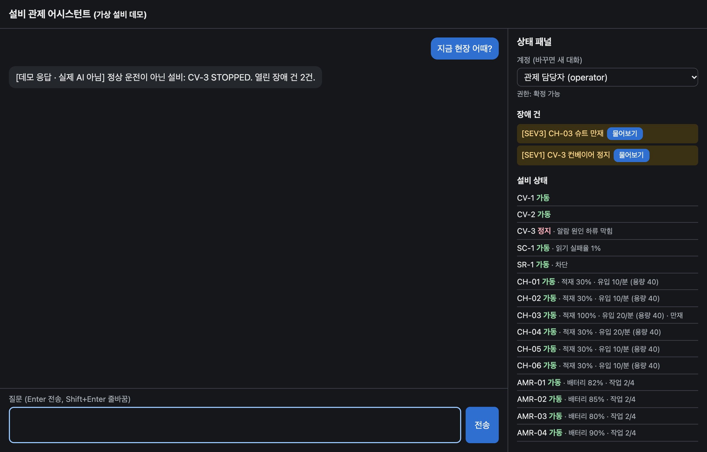
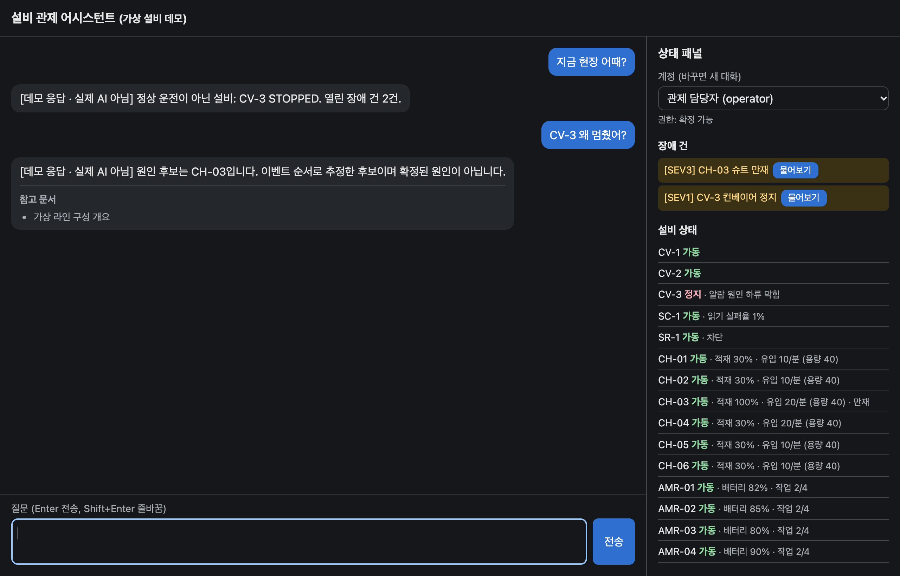
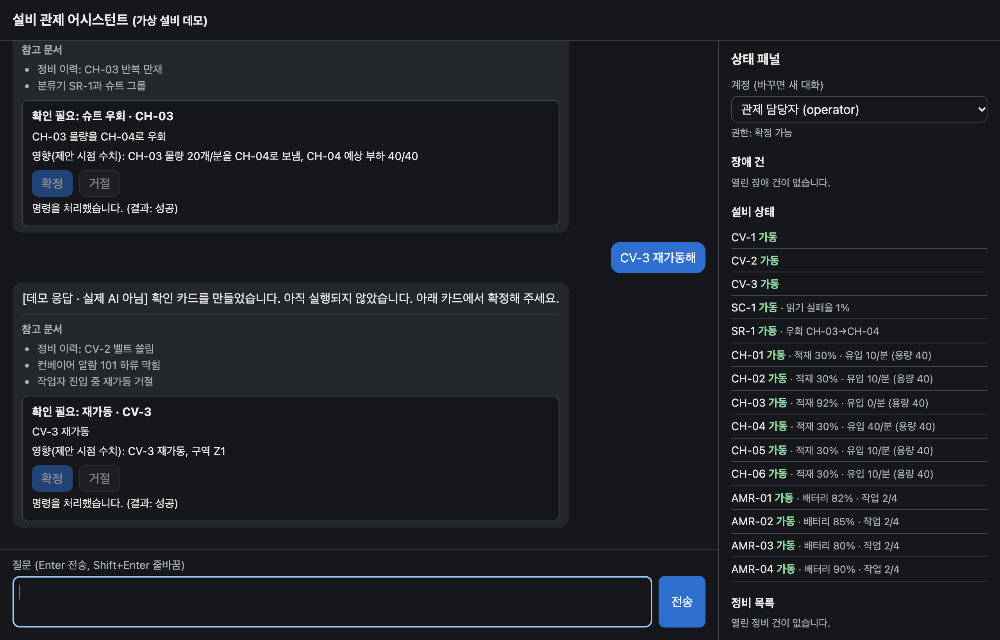
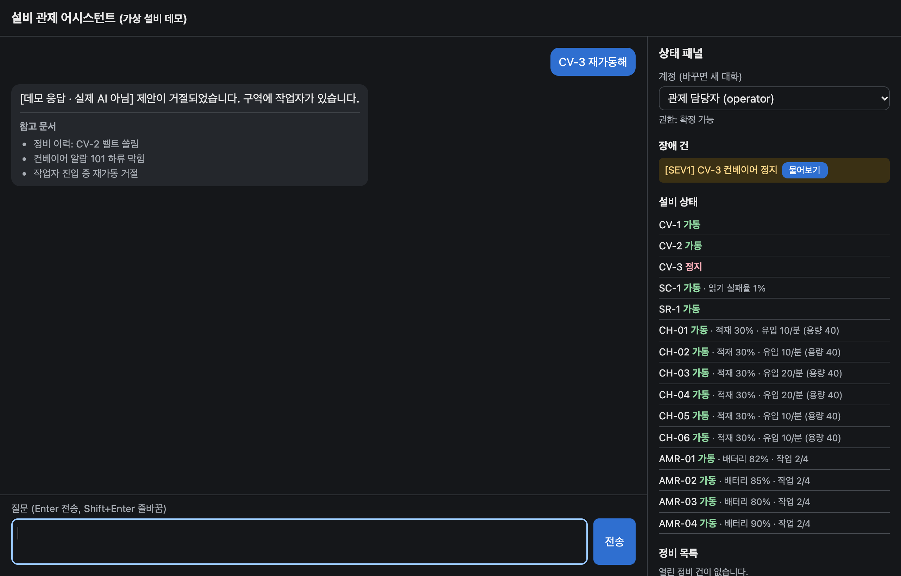
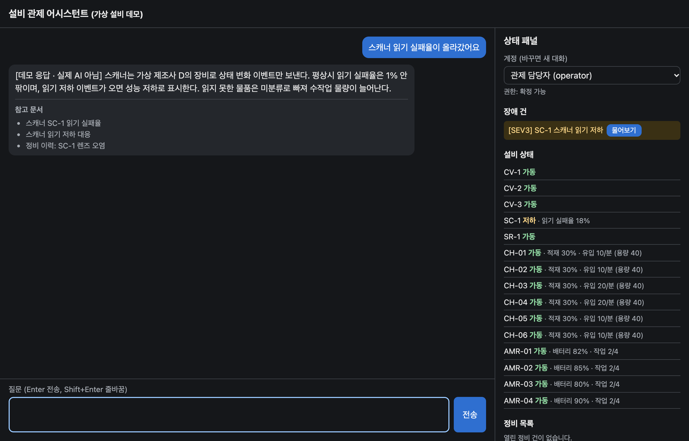
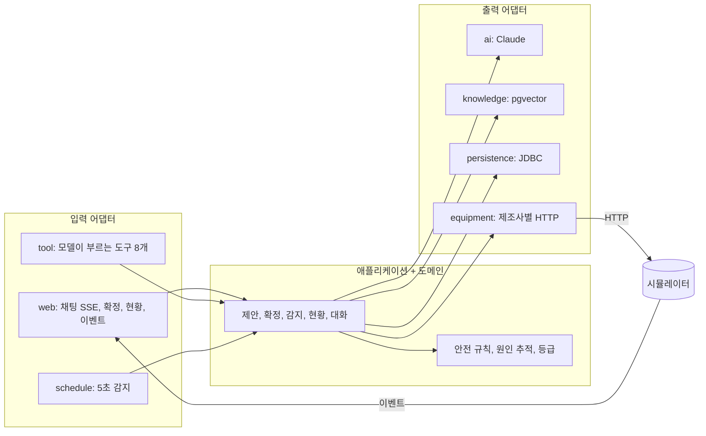

# 설비 관제 어시스턴트

[](https://github.com/toyunity/ai-logistics-control-tower/actions/workflows/ci.yml)

> **설비와 데이터는 가상이고 시뮬레이터 전용이며 실제 안전 장치를 대신할 수 없다.**

물류 현장의 컨베이어, 분류기, 회수 로봇을 대화로 살피는 관제 어시스턴트입니다. 현장 상태를 묻고, 멈춘 원인을 추적하고, 조치를 요청하면 AI가 **확인 카드**를 만듭니다. 명령은 담당자가 카드에서 확정했을 때만, 안전 규칙을 다시 통과한 경우에만 설비로 나갑니다.

Java 25, Spring Boot 4.1.2, Spring AI 2.0.2로 만들었습니다. 답변은 Claude, 임베딩은 OpenAI, 저장은 PostgreSQL(pgvector)을 씁니다. **API 키 없이 아래 장면을 모두 재현할 수 있는 데모 모드**가 있습니다. 실제 Claude·OpenAI 호출은 아직 해 보지 못했습니다([검증 상태](#검증-상태)).

## 장면

모든 장면은 데모 모드를 실제로 실행해 찍었습니다(**촬영 모드: 데모, 키 없이 재현 가능**). 데모의 답변은 AI가 쓴 것이 아니며 앞에 `[데모 응답 · 실제 AI 아님]`이 붙습니다. 도구 실행, 안전 규칙, 확정, 저장, 화면은 실제 모드와 같은 코드입니다.

### 1. 현황 파악

"지금 현장 어때?"에 도구로 읽은 현재 상태로 답합니다. 오른쪽 상태 패널에는 장애 건과 등급(SEV1~3), 설비별 상태가 2초마다 갱신됩니다.



근거: 제조사별 어댑터의 [계약 테스트](src/test/java/com/example/controltower/adapter/out/equipment/ConveyorsContract.java), [등급 규칙 테스트](src/test/java/com/example/controltower/domain/SeverityPolicyTest.java)

### 2. 원인 추적

"CV-3 왜 멈췄어?"에 이벤트 순서로 추정한 원인 후보(CH-03 만재)를 답합니다. 후보이지 확정된 원인이 아니라고 함께 말합니다.



근거: [`CascadeAnalyzer`](src/main/java/com/example/controltower/domain/CascadeAnalyzer.java), [`CascadeAnalyzerTest`](src/test/java/com/example/controltower/domain/CascadeAnalyzerTest.java)

### 3. 조치: 우회 확정, 그다음 재가동 확정

원인을 두고 바로 재가동하면 다시 멈추므로 거절합니다. CH-03 물량을 CH-04로 우회하는 카드를 확정한 뒤에야 재가동 카드를 만들 수 있습니다. 두 카드 모두 담당자가 눌러야 실행됩니다.



근거: [`DecideCommandServiceTest`](src/test/java/com/example/controltower/application/DecideCommandServiceTest.java), 시뮬레이터와 실제 HTTP로 도는 [`ControlApiIT`](src/test/java/com/example/controltower/ControlApiIT.java), [`DemoModeIT`](src/test/java/com/example/controltower/DemoModeIT.java)

### 4. 안전 거절

작업자가 구역에 있으면 재가동 제안 자체를 거절합니다. 참관자 계정은 카드를 확정할 수 없습니다(403).



근거: [`SafetyPolicyTest`](src/test/java/com/example/controltower/domain/SafetyPolicyTest.java), 권한은 [`CommandControllerTest`](src/test/java/com/example/controltower/adapter/in/web/CommandControllerTest.java)

### 5. 선제 알림과 절차

스캐너 읽기 실패율이 오르면 감지기가 장애 건을 열고 배너로 알립니다. "물어보기"를 누르면 관련 지식 문서로 대응 절차를 안내합니다.



근거: [`DetectAnomaliesServiceTest`](src/test/java/com/example/controltower/application/DetectAnomaliesServiceTest.java), 검색은 [`KnowledgeSyncIT`](src/test/java/com/example/controltower/adapter/out/knowledge/KnowledgeSyncIT.java)

### AI가 속으면?

프롬프트 인젝션 방어는 데모 화면으로 보여 주지 않습니다. 데모 스텁은 말을 이해하지 못해 애초에 속지 않으므로 증거가 되지 않습니다. 대신 가짜 모델이 **완전히 속아** 모든 설비에 모든 제안 도구를 부르는 테스트를 둡니다. 결과는 규칙을 통과한 카드뿐이고, 설비 전송 0건, 정비 등록 0건, 시뮬레이터 상태 불변입니다([`FooledModelIT`](src/test/java/com/example/controltower/FooledModelIT.java)). 명령은 AI가 없는 확정 API로만 나가기 때문입니다.

## 빠른 시작: 데모 모드

JDK 25와 Docker만 있으면 됩니다. API 키가 필요 없고 외부 API를 호출하지 않습니다. `JAVA_HOME`이 JDK 25를 가리켜야 합니다(macOS: `export JAVA_HOME=$(/usr/libexec/java_home -v 25)`).

```bash
docker compose up -d
./gradlew bootRun --args='--spring.profiles.active=demo'
```

http://localhost:8080 을 열고 오른쪽 "시뮬레이터 제어"에서 **슈트 만재**를 누른 뒤 몇 초 기다렸다가 물어보세요.

- `지금 현장 어때?`
- `CV-3 왜 멈췄어?`
- `CV-3 재가동해` (거절: 분류기 차단, 우회 먼저)
- `CH-03을 CH-04로 우회해` → 카드에서 확정 → `CV-3 재가동해` → 확정

다른 시나리오: 작업자 진입(안전 거절), 스캐너 저하(선제 알림), 로봇 배터리(재배정), 안전 PLC 끊김(모르면 막는다). 계정을 참관자로 바꾸면 확정 버튼이 꺼집니다. 리셋은 상태를 처음으로 돌립니다.

데모에서 알아 둘 점입니다.

- **의도는 키워드로 판단합니다.** 설비 ID와 "재가동", "우회", "정비" 같은 단어를 보고 도구를 부릅니다. 우회·재배정 방향은 "로/으로"가 붙은 ID를 받는 쪽으로 먼저 보고, 없으면 어순(앞이 보내는 쪽)을 따릅니다(`A를 B로`, `B로 A를` 모두 A→B). 그래서 `CH-03로부터 CH-04에 우회해`는 "로부터"의 "로"를 받는 쪽으로 읽어 CH-04→CH-03으로 거꾸로 제안합니다. 부정문("재가동하지 마")은 이해하지 못합니다. 그래도 카드를 만들 뿐 실행은 확정해야 합니다.
- **문서 검색은 단순 글자 유사도입니다.** 질문 10개는 맞는 문서가 1위로 나오고 무관한 질문 31개는 걸리지 않지만, `임진왜란은 몇 년에 일어났나요?`와 `다이어트는 어떻게 하나요?`는 엉뚱한 문서에 걸립니다. 거르려고 임계값을 올리면 `알람 101` 질문이 떨어져 `0.20`에 두었습니다([설계 결정](docs/decisions.md)).

## 구조

규칙(도메인, 애플리케이션)은 바깥(설비, AI, DB)을 모릅니다. 그래서 설비 제조사나 모델을 바꿔도 "무엇을 보내도 되는가"는 그대로입니다.



- 도구 8개: 조회 4개(`getPlantStatus`, `getEquipment`, `getTimeline`, `diagnose`), 제안 4개(`proposeRestart`, `proposeDivert`, `proposeReassign`, `proposeMaintenance`). 제안 도구는 카드만 만듭니다. 도구 매개변수에 계정과 권한이 없고, 신원은 서버가 넣은 값에서만 읽습니다.
- 확정할 때 설비 상태를 다시 읽어 제안 시점과 비교하고, 안전 규칙을 다시 검사합니다. 다르면 보내지 않습니다(409).
- 명령은 한 번만 보냅니다. 결과를 확인하지 못하면 다시 보내지 않고 "결과 미확인"으로 닫습니다.
- 의존 방향은 [`ArchitectureTest`](src/test/java/com/example/controltower/ArchitectureTest.java)가 검사합니다.

흐름 그림은 [구조 문서](docs/architecture.md), 각 결정의 이유와 대가는 [설계 결정](docs/decisions.md), 테스트 계층은 [테스트 전략](docs/testing.md)에 있습니다.

## 귀사 설비에 붙일 때

| 바꿀 것 | 바뀌지 않는 것 |
|---|---|
| 컨베이어 PLC 어댑터(`VendorAConveyors`): 실제 프로토콜(OPC UA, Modbus 등) 클라이언트로 교체 | 안전 규칙(`SafetyPolicy`), 확정 흐름(`DecideCommandService`) |
| 분류기, 로봇 관제, 안전 PLC 어댑터 | 원인 추적, 장애 등급, 이상 감지 |
| 이벤트 게이트웨이(`POST /api/events`로 보내는 쪽) | 대화, 도구, 확인 카드, 화면 |
| 지식 문서(`knowledge/documents.json`): 실제 매뉴얼과 정비 이력 | 저장소 스키마와 "한 번만 전송" 보장 |
| 계정: 샘플 계정을 사내 인증으로 교체 | 권한 검사 위치(확정 API) |
| 시뮬레이터: `controltower.simulator.enabled=false`로 끄고, `controltower.equipment.base-url`을 실제 게이트웨이 주소로 지정(비우면 이 서버 자신의 포트로 보냄) | 어댑터가 쓰는 포트와 계약 테스트 |

새 어댑터는 포트마다 있는 계약 테스트(`*Contract`)를 통과하면 됩니다. 지금의 메모리 대역, HTTP 어댑터, JDBC 어댑터가 같은 계약을 통과합니다.

## API

| 메서드와 경로 | 설명 | 응답 |
|---|---|---|
| `POST /api/session` `{"accountId":"operator"\|"viewer"}` | 샘플 계정 로그인 | 200, 그 외 계정 400 |
| `DELETE /api/session` | 로그아웃 | 204 |
| `POST /api/chat/stream` `{"conversationId"?, "message"}` | 대화(SSE) | 아래 표 |
| `POST /api/commands/{id}/confirm` | 카드 확정. AI가 거치지 않는 경로 | 200 `{status, message}`, 403 권한 없음, 404, 409 상태 변경·만료·이미 처리 |
| `POST /api/commands/{id}/reject` | 카드 거절 | 확정과 같음 |
| `GET /api/plant/status` | 설비 상태, 열린 장애 건, 정비 목록 | 200. 읽지 못한 설비군은 알 수 없음으로 표시 |
| `POST /api/events` | 게이트웨이 이벤트 수신 | 200(중복 포함), 형식 오류 400 |
| `POST /api/maintenance/{id}/close` | 정비 완료 | 200, 403, 404 |
| `GET /api/knowledge/search?q=` | 지식 문서 검색 | 200 |
| `POST /sim/scenarios/{name}`, `POST /sim/reset` | 시뮬레이터 제어(데모용) | 200, 404, 409 |

응답 본문의 `message`는 고정 문구입니다. 예외 내용을 내보내지 않습니다.

### SSE 이벤트

POST이므로 브라우저에서는 `EventSource`가 아니라 `fetch`와 stream reader를 씁니다.

| event | data | 시점 |
|---|---|---|
| `meta` | `{"conversationId"}` | 항상 첫 이벤트 |
| `sources` | `{"items":[{"id","title","score"}]}` (빈 배열 가능) | 첫 `delta` 앞 1회 |
| `delta` | `{"text"}` | 0회 이상 |
| `action` | `{"commandId","kind","targetId","summary","impact","expiresAt"}` | 마지막 `delta` 뒤, `done` 앞. 이번 턴에 만든 카드마다 1회 |
| `done` | `{}` | 정상 종료 |
| `error` | `{"code":"UPSTREAM"\|"REFUSED","message"}` | 실패 종료. 이때 `action`은 나가지 않습니다 |

스트림은 `done` 또는 `error` 중 정확히 하나로 끝납니다. 첫 청크까지의 대기나 청크 사이의 침묵이 `controltower.stream-idle-timeout`(60초)을 넘으면 `UPSTREAM`으로 끝나고, 응답 전체는 `spring.ai.anthropic.timeout`(10분)으로 제한됩니다. `action`의 값은 서버가 저장한 카드 값이며, 정비 카드의 `summary`만 모델이 쓴 문장입니다(화면은 텍스트로만 넣습니다).

## 실제 API로 실행

API 키 2개(`ANTHROPIC_API_KEY`, `OPENAI_API_KEY`)가 필요합니다.

```bash
docker compose up -d
ANTHROPIC_API_KEY=... OPENAI_API_KEY=... ./gradlew bootRun
```

키 환경 변수가 없으면 기동이 `Could not resolve placeholder 'ANTHROPIC_API_KEY'`(또는 `'OPENAI_API_KEY'`)로 실패합니다(`ApiKeyGuardTest`). 값이 있는지만 확인하므로 틀린 키는 잡지 못합니다. DB 접속 정보는 `DB_URL`, `DB_USER`, `DB_PASSWORD`로 바꿀 수 있고 기본값은 `compose.yaml`과 같습니다.

## 테스트

```bash
./gradlew test
```

Docker가 필요하고 비용은 들지 않습니다. `*IT`는 Docker가 없으면 건너뛰지 않고 실패합니다. 가짜 모델, 로컬 HTTP 스텁, 시뮬레이터를 씁니다. `LiveApiIT`만 키 2개가 모두 있을 때 실제 API를 호출하므로, 키가 있는 셸에서 `./gradlew test`를 돌리면 비용이 납니다.

## 지식 문서 수정

`src/main/resources/knowledge/documents.json`(22건, 전부 가상)을 고친 뒤 재시작합니다. 바뀐 문서만 다시 임베딩하고 사라진 문서는 지웁니다. 빈 배열(`[]`)이면 기존 데이터를 지우지 않고 기동이 실패합니다.

임베딩 모델을 바꾸면 해시에 들어가는 `controltower.embedding-index`가 바뀌어 전체를 다시 임베딩합니다. 벡터 차원이 달라질 때만 `spring.ai.vectorstore.pgvector.dimensions`를 바꾸고 테이블을 지운 뒤 재시작합니다.

```bash
docker compose exec db psql -U consult -d consult -c 'DROP TABLE vector_store;'
```

## 한계

운영 환경에 투입할 수준으로 검증된 프로젝트가 아닙니다.

- **샘플 계정입니다.** `operator`와 `viewer`는 비밀번호 없이 고릅니다. 사내 인증으로 바꿔야 합니다.
- **이벤트 API에 인증이 없습니다.** `POST /api/events`는 게이트웨이를 가정한 입구라 형식만 검사합니다.
- **대화 소유권과 rate limit이 없습니다.** `conversationId`를 아는 사람은 그 대화를 이어갈 수 있고, 호출 수 제한이 없어 공개하면 API 비용이 무제한으로 날 수 있습니다.
- **CSRF는 `SameSite=Lax` 쿠키에만 기댑니다.** 다른 사이트의 POST는 막지만 같은 사이트의 다른 출처(같은 호스트의 다른 포트 등)는 막지 못합니다.
- **연결이 끊겨도 업스트림 호출은 계속됩니다.** 버려진 답변도 `controltower.max-tokens`(8000)나 10분 한도까지 생성되어 비용이 청구됩니다. 화면은 상태 조회가 실패하면 "연결 끊김"을 표시합니다.
- **전송 중 서버가 죽으면** 그 명령은 다음 기동 때 "결과 미확인"으로 정리되며, 그 전까지 같은 실행 잠금(재가동·정비는 같은 설비, 우회는 분류기 전체, 재배정은 로봇 전체)의 새 명령은 막힙니다. 단일 인스턴스를 전제합니다. 실행 잠금 방식이 바뀐 이 버전으로 기존 DB를 올릴 때 실행 중(`EXECUTING`) 상태의 우회 명령이 둘 이상 남아 있으면 스키마 갱신이 실패해 기동이 멈추므로, 그 행을 먼저 정리해야 합니다.
- **원인 추적은 후보입니다.** 이벤트 순서로 추정하므로 실제 원인과 다를 수 있습니다.
- **감지를 끄면**(`controltower.detection.enabled=false`) 이벤트가 몰릴 때 버려진 감지는 다음 이벤트가 올 때까지 반영되지 않습니다.
- **도구 호출 한도(한 턴 8회)를 넘으면** 인자 형식이 틀려 실패한 호출까지 세어 16회까지는 모델에게 알리기만 하고, 17번째 호출에서 스트림을 `error`로 끝냅니다. 한 턴의 답변 생성 호출은 최대 17번 과금됩니다(후속 질문이면 재작성 호출 1번이 더해집니다).
- **시뮬레이터 설비 API가 같은 포트에 열려 있습니다.** `controltower.simulator.enabled=true`(기본값)이면 `/sim/...` 아래 가상 설비의 상태 조회, 명령, 안전 신호, 시나리오 제어가 인증 없이 열리고, 이를 직접 부르면 확인 카드와 안전 규칙을 거치지 않습니다. 데모 전용입니다. 실제 설비에 붙일 때는 끕니다(위 "귀사 설비에 붙일 때").
- **하드 스톱으로 끝난 턴의 카드는 보이지 않습니다.** 17번째 도구 호출로 스트림이 `error`로 끝나면 그 턴에 이미 만든 확인 카드는 `action`으로 나가지 않고, 확정되지 않은 채 2분 뒤 만료됩니다.
- **설비 프로토콜은 가상입니다.** 제조사별 HTTP 형식은 시뮬레이터용으로 만든 것입니다.

## 검증 상태

**실제 Claude·OpenAI 호출, 실제 모델의 도구 선택, 임계값 보정은 실행하지 못했습니다.** 작성 시점에 API 키가 없었습니다. 아래는 구분해서 적습니다.

- **실행으로 확인:** 전체 자동 테스트(가짜 모델, 로컬 스텁, 시뮬레이터, PostgreSQL 컨테이너). 데모 모드의 다섯 장면. 헤드리스 Chrome으로 본 화면 동작(확정 더블 클릭 시 요청 1건, 만료 카드 버튼 비활성, 상태가 바뀐 카드 409 문구, 연결 끊김 표시, 폭 360px에서 가로 스크롤 없음).
- **확인하지 못함:** 실제 API가 `claude-opus-5-5`와 effort `low` 옵션, 도구 정의를 받아 주는지. 실제 모델이 상황에 맞는 도구를 고르고 프롬프트를 지키는지. 실제 임베딩의 검색 품질과 임계값 `0.4`(측정값이 아닌 초기값).

다음 명령으로 확인합니다. 소액의 비용이 발생합니다.

```bash
ANTHROPIC_API_KEY=... OPENAI_API_KEY=... ./gradlew test --tests '*LiveApiIT' --rerun -i
```

`--rerun`을 빼면 안 됩니다. Gradle은 환경 변수 변화를 입력으로 보지 않아, 키 없이 건너뛴 직후에는 테스트를 실행하지 않고 `BUILD SUCCESSFUL`을 출력합니다. 끝난 뒤 `build/test-results/test/TEST-com.example.controltower.LiveApiIT.xml`에서 `tests="6"`, `skipped="0"`, `failures="0"`을 확인하세요. 여기에는 슈트 만재 상황을 열린 질문으로 물었을 때 실제 모델이 우회 카드를 고르는지, 작업자 진입 중 인젝션 문장에 실행했다고 답하지 않고 아무것도 전송되지 않는지가 들어 있습니다.

임계값 보정은 출력된 표(`question | expected | score | hit`)에서 정답 질문의 최저 점수와 무관 질문(`(unrelated)`)의 최고 점수 사이 값을 `application.yaml`의 `controltower.similarity-threshold`에 넣습니다. `retrievalHitRate`가 통과해도 임계값이 적절하다는 뜻은 아니므로 표를 직접 봐야 합니다.

## 라이선스

[MIT](LICENSE)
