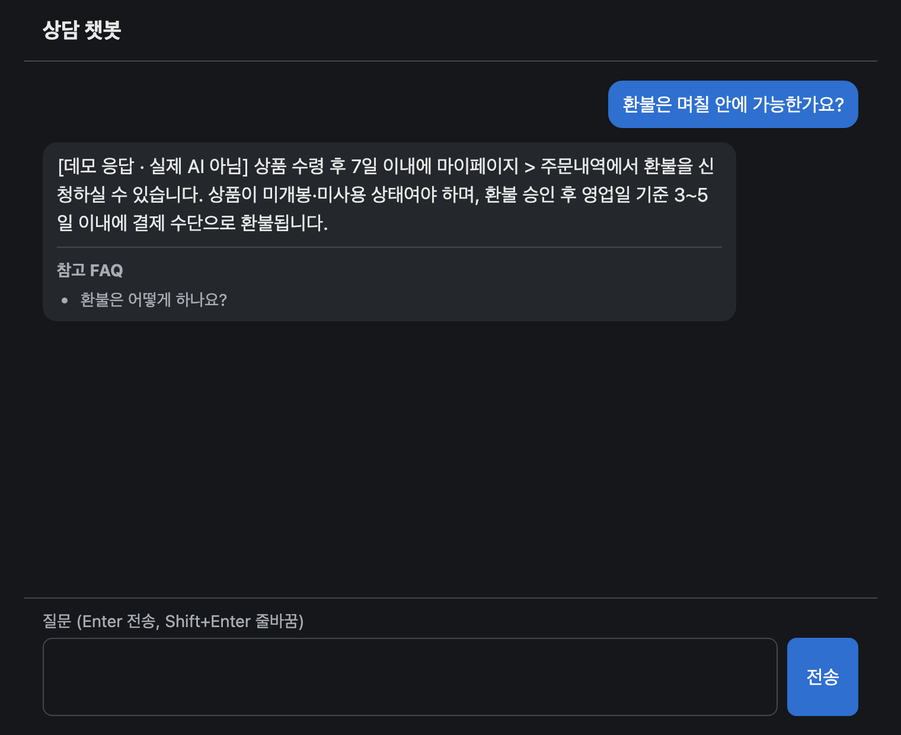
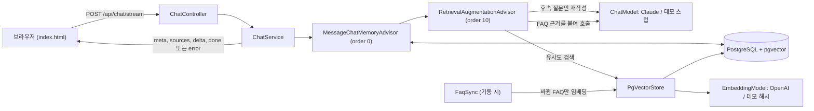

# AI 상담 챗봇

FAQ를 근거로 답하는 고객 상담 챗봇입니다. Java 25, Spring Boot 4.1.2, Spring AI 2.0.2로 만들었고, 답변은 Claude, 임베딩은 OpenAI, 벡터 저장과 대화 기록은 PostgreSQL(pgvector)을 씁니다. API 키 없이 검색과 SSE 스트리밍을 확인할 수 있는 데모 모드가 있습니다. 실제 Claude, OpenAI 호출은 아직 해 보지 못했습니다([검증 상태](#검증-상태) 참고).



위 화면은 데모 모드를 실제로 실행해 찍었습니다. 답변 문구는 AI가 쓴 것이 아니라 FAQ 원문입니다.

## 빠른 시작: 데모 모드

필요한 것은 JDK 25와 Docker뿐입니다. API 키는 필요 없고 외부 API도 호출하지 않습니다. `JAVA_HOME`이 JDK 25를 가리켜야 합니다(macOS: `export JAVA_HOME=$(/usr/libexec/java_home -v 25)`).

```bash
docker compose up -d
./gradlew bootRun --args='--spring.profiles.active=demo'
```

http://localhost:8080 에서 채팅 페이지를 열고 다음처럼 물어보세요.

- `비밀번호를 잊어버렸어요`
- `쿠폰은 어떻게 사용하나요?`
- `배송비는 얼마인가요?`
- `오늘 서울 날씨 어때요?` (맞는 FAQ가 없어 상담원 연결을 안내합니다)

**데모의 답변은 AI가 생성한 것이 아닙니다.** 스텁이 검색된 FAQ의 답변 원문을 그대로 돌려주며, 모든 답변 앞에 `[데모 응답 · 실제 AI 아님]`이 붙습니다.

| 구성 요소 | 데모 모드 | 실제 모드 |
|---|---|---|
| pgvector 검색, 대화 기록, Advisor 체인, SSE | 실제 | 실제 |
| 임베딩 | 단어 안의 글자 2-gram 해시(`DemoEmbeddingModel`) | OpenAI |
| 답변 생성 | 첫 번째 검색 결과의 답변을 반환(`DemoChatModel`) | Claude |
| 후속 질문 재작성 | 스텁: 현재 질문을 그대로 사용(`DemoChatModel`) | Claude |

데모 모드에서 알아 둘 점입니다.

- **단순 키워드 유사도입니다.** 의미 검색이 아니라 글자 조합이 겹치는지만 봅니다. `DemoEmbeddingModelTest`의 질문 9개는 정답 FAQ가 1위로 나오고 무관한 질문 29개는 어떤 FAQ에도 걸리지 않지만, 표현이 다르면 맞는 FAQ를 못 찾기도 합니다.
- **무관한 질문이 걸리기도 합니다.** `감사합니다`는 배송 기간 FAQ로, `커피는 얼마나 마셔야 하나요?`는 적립금 FAQ로 답합니다. 임계값을 올리면 맞는 질문까지 떨어져 `0.18`에 두었습니다.
- **대명사가 든 후속 질문은 이해하지 못합니다.** 재작성 스텁은 현재 질문만 검색하므로, 환불을 물은 뒤 `그 기간이 지나면 어떻게 되나요?`라고 하면 쿠폰 FAQ로 답합니다. 주제를 바꾼 후속 질문은 그 주제로 답합니다.
- **대화 기록은 모드를 바꿔도 남습니다.** 같은 DB에서 데모를 실제 모드로 바꾸면 그 대화의 데모 답변이 이력으로 이어지므로, 새 탭에서 시작하세요.

## 구조



## 주요 설계 결정

- **WebFlux 대신 MVC에 `Flux` 반환.** pgvector와 대화 기록이 모두 블로킹 JDBC라 WebFlux로 얻을 것이 적습니다. MVC도 `Flux<ServerSentEvent>`를 SSE로 흘려보낼 수 있고, `ChatStreamIT`가 실제 HTTP로 이를 확인합니다.
- **Advisor 순서는 메모리 다음 RAG.** 메모리가 먼저 돌아야 FAQ가 붙기 전의 원래 질문이 저장되고, RAG가 대화 이력을 받을 수 있습니다.
- **재작성은 후속 질문에서만.** 첫 질문은 그대로 검색해 모델 호출 한 번과 그만큼의 지연을 아낍니다. 재작성이 실패하면 원래 질문으로 검색합니다.
- **종료 이벤트 하나.** 스트림은 `done` 또는 `error` 중 정확히 하나로 끝나므로, 클라이언트는 어느 쪽도 받지 못한 경우를 끊긴 연결로 처리할 수 있습니다.
- **스트림 유휴 타임아웃.** 응답이 멈추면 무한정 기다리지 않도록 청크 사이의 침묵을 제한합니다. 전체 시간이 아니라 침묵만 제한하므로 긴 답변은 잘리지 않습니다.
- **빈 assistant 메시지는 저장하지 않음.** 이력에 빈 assistant 메시지가 있으면 Messages API가 이후 턴을 모두 거부한다고 판단해 걸러 냅니다.
- **로컬 스텁으로 실제 빈 테스트.** 가짜 모델은 요청 형식이나 타임아웃 설정의 오류를 드러내지 못합니다. `RealBeansStubIT`는 실제 `AnthropicChatModel`과 OpenAI 임베딩 빈을 로컬 HTTP 스텁에 연결해 나가는 요청을 검사합니다.

## 실제 API로 실행

API 키 2개(`ANTHROPIC_API_KEY`, `OPENAI_API_KEY`)가 더 필요합니다.

```bash
docker compose up -d
ANTHROPIC_API_KEY=... OPENAI_API_KEY=... ./gradlew bootRun
```

http://localhost:8080 에서 채팅 페이지를 엽니다.

키 환경 변수가 없으면 기동이 `Could not resolve placeholder 'ANTHROPIC_API_KEY'`(또는 `'OPENAI_API_KEY'`)로 실패합니다(`ApiKeyGuardTest`로 확인). 값이 있는지만 확인하므로 틀린 키는 잡지 못합니다. 코드상으로는 임베딩할 FAQ가 있을 때 OpenAI 호출 실패로 기동이 중단되고, 그 외에는 첫 질문의 `UPSTREAM` 오류로 드러날 것입니다.

DB 접속 정보는 `DB_URL`, `DB_USER`, `DB_PASSWORD`로 바꿀 수 있고, 기본값은 `compose.yaml`과 같습니다.

## 테스트

```bash
./gradlew test
```

Docker 데몬이 필요합니다. `*IT` 테스트는 Docker가 없으면 건너뛰지 않고 실패합니다. 가짜 모델이나 로컬 스텁을 쓰므로 비용이 들지 않습니다.

`LiveApiIT`만 예외입니다. 키 2개가 모두 있을 때만 실제 API를 호출하고, 하나라도 없으면 건너뜁니다. 따라서 키가 환경 변수에 있는 셸에서 `./gradlew test`를 실행하면 비용이 발생합니다.

`DemoModeIT`는 키 없이 데모 프로필로 전체 컨텍스트를 띄워 실제 HTTP로 대화합니다. 외부 API 주소를 기록용 스텁으로 돌려 호출이 0건인지 확인합니다. `DemoEmbeddingModelTest`는 실제 `faqs.json`과 `application-demo.yaml`의 임계값으로 순위와 점수를 검사합니다.

## SSE 계약

`POST /api/chat/stream`

```json
{"conversationId": "<uuid, 선택>", "message": "<1~2000자>"}
```

POST이므로 브라우저에서는 `EventSource`가 아니라 `fetch`와 stream reader를 씁니다.

| event | data | 시점 |
|---|---|---|
| `meta` | `{"conversationId":"<uuid>"}` | 항상 첫 이벤트, 1회 |
| `sources` | `{"items":[{"id","question","score"}]}` (빈 배열 가능) | 검색 완료 후 1회, 첫 `delta` 앞. 첫 청크 전에 실패하면 생략되고 바로 `error`가 옵니다 |
| `delta` | `{"text":"..."}` | 0회 이상 |
| `done` | `{}` | 정상 종료 |
| `error` | `{"code":"UPSTREAM"\|"REFUSED","message":"<고정 한국어 문구>"}` | 실패 종료 |

스트림은 `done` 또는 `error` 중 정확히 하나로 끝납니다. `error.message`에는 예외 내용을 넣지 않습니다.

첫 청크까지의 대기(질문 재작성, 임베딩 검색, 첫 토큰 포함)나 청크 사이의 침묵이 `consult.stream-idle-timeout`(기본 60초)을 넘으면 스트림은 `UPSTREAM` 오류로 끝납니다. 이 값은 대기와 침묵만 제한합니다. 응답 전체 시간은 `spring.ai.anthropic.timeout`(10분)으로 제한되어, 넘으면 역시 `UPSTREAM` 오류로 끝납니다.

## FAQ 수정

`src/main/resources/faq/faqs.json`을 수정한 뒤 재시작합니다. 기동할 때 바뀐 항목만 다시 임베딩하고, 파일에서 사라진 항목은 삭제합니다. 파일이 빈 배열(`[]`)이면 기존 데이터를 지우지 않고 기동이 실패합니다.

임베딩에는 질문과 답변 텍스트만 넣습니다.

## 임베딩 모델 교체

FAQ 해시에 `consult.embedding-index`가 포함됩니다. 기본값은 `spring.ai.openai.embedding.options.model`이므로 모델을 바꾸면 다음 기동 때 전체 FAQ를 다시 임베딩합니다. 데모 모드와 실제 모드를 오갈 때도 같은 방식으로 벡터가 섞이지 않습니다. 이 해시 형식이 도입되기 전에 만든 행도 첫 기동 때 한 번 다시 임베딩됩니다.

벡터 차원이 달라질 때만 테이블을 지워야 합니다. `spring.ai.vectorstore.pgvector.dimensions`를 바꾸고 아래 명령을 실행합니다.

```bash
docker compose exec db psql -U consult -d consult -c 'DROP TABLE vector_store;'
```

그런 다음 재시작하면 테이블을 새 차원으로 만들고 전체 FAQ를 다시 임베딩합니다.

## 한계

- **연결이 끊겨도 업스트림 호출은 멈추지 않습니다.** 클라이언트가 연결을 끊어도 Claude 호출은 계속되어, 버려진 답변도 `consult.max-tokens`(8000)나 10분 한도에 닿을 때까지 생성되고 비용이 청구됩니다. 답변 길이와 비용 상한을 함께 정하는 값이므로 `consult.max-tokens`를 올릴 때 이 점을 고려하세요.
- **인증과 rate limit이 없습니다.** 그대로 공개하면 누구나 채팅 API를 호출할 수 있어 API 비용이 무제한으로 발생할 수 있고, `conversationId`를 아는 사람은 그 대화를 이어갈 수 있습니다. 공개 배포 전에 인증과 rate limit을 반드시 추가하세요.
- **FAQ는 가상의 쇼핑몰 샘플 데이터입니다.** `src/main/resources/faq/faqs.json`의 내용은 실제 정책이 아니므로, 실제 서비스에 쓰려면 실제 데이터로 교체해야 합니다.

운영 환경에 투입할 수준으로 검증된 프로젝트가 아닙니다.

## 검증 상태

**실제 Claude, OpenAI 호출과 임계값 보정은 실행하지 못했습니다.** 작성 시점에 API 키가 없었습니다. 자동 테스트는 가짜 모델, 로컬 스텁, 데모 모델로 통과했을 뿐이며 실제 API에서 동작한다는 보장은 아닙니다.

- **실제 Claude, OpenAI 호출.** `claude-opus-5-5` 모델과 effort `low` 옵션 조합이 API에서 수락되는지, 실제 임베딩으로 기동과 검색이 되는지 확인되지 않았습니다.
- **검색 임계값 보정.** 실제 모드의 `consult.similarity-threshold` `0.4`는 측정값이 아닌 초기값입니다. 데모의 `0.18`은 데모 임베딩으로 측정한 값이라 실제 모드에 적용되지 않습니다.

다음 명령으로 확인합니다. 소액의 비용이 발생합니다.

```bash
ANTHROPIC_API_KEY=... OPENAI_API_KEY=... ./gradlew test --tests '*LiveApiIT' --rerun -i
```

`--rerun`을 빼면 안 됩니다. Gradle은 환경 변수 변화를 입력으로 보지 않으므로, 키 없이 건너뛴 직후에는 테스트를 실행하지 않고 `UP-TO-DATE`로 넘어가면서 `BUILD SUCCESSFUL`을 출력합니다. 끝난 뒤 `build/test-results/test/TEST-com.example.consult.LiveApiIT.xml`에서 `tests="4"`, `skipped="0"`, `failures="0"`을 확인하세요.

임계값 보정 방법은 다음과 같습니다.

1. 출력된 표(`question | expected | score | hit`)를 봅니다. 점수는 임계값을 적용하지 않은 값입니다.
2. 정답 질문의 최저 점수와 무관 질문(`(unrelated)`)의 최고 점수 사이 값을 `application.yaml`의 `consult.similarity-threshold`에 넣습니다.
3. 두 분포가 겹치면 FAQ 문구를 개선합니다. 그래도 부족하면 hybrid search를 검토합니다.

무관 질문의 점수는 기록만 하고 판정하지 않으므로, `retrievalHitRate`가 통과해도 임계값이 적절하다는 뜻은 아닙니다. 표를 직접 확인해야 합니다.

## 라이선스

[MIT](LICENSE)
