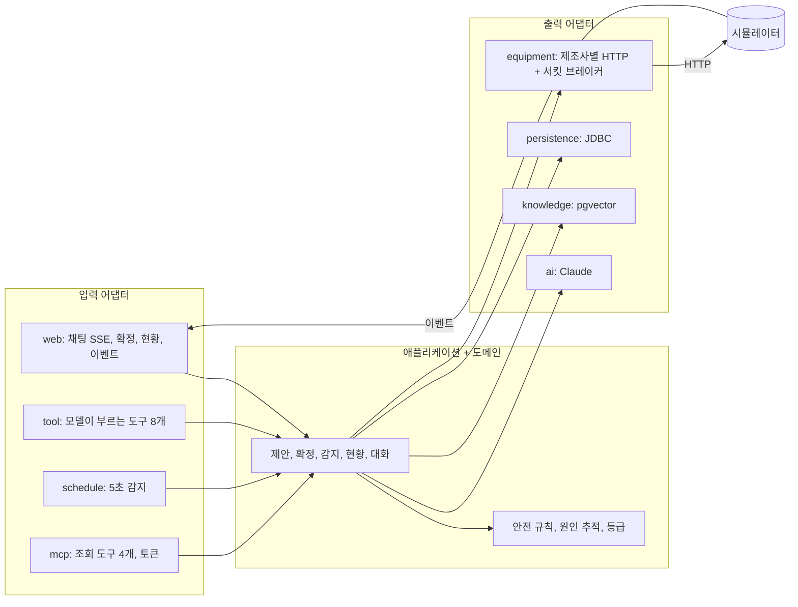

# 설비 관제 어시스턴트

[](https://github.com/toyunity/ai-logistics-control-tower/actions/workflows/ci.yml)

> **설비와 데이터는 가상이고 시뮬레이터 전용이며 실제 안전 장치를 대신할 수 없다.**

물류 현장의 컨베이어, 분류기, 회수 로봇을 대화로 살피는 관제 어시스턴트입니다. 상태를 묻고, 멈춘 원인을 찾고, 조치를 요청하면 AI가 **확인 카드**를 만듭니다. 명령은 담당자가 카드를 확정하고 안전 규칙을 다시 통과했을 때만 설비로 나갑니다.


## 핵심

- **AI는 제안만 합니다.** 모델이 쓸 수 있는 도구는 조회와 카드 만들기뿐입니다. 확정은 AI를 거치지 않는 HTTP API로 사람이 합니다.
- **모르면 막습니다.** 확정할 때 설비 상태를 다시 읽어 제안 시점과 다르거나, 안전 신호가 오래됐거나, 작업자가 구역에 있으면 보내지 않습니다.
- **한 번만 보냅니다.** 동시에 눌러도 DB 제약이 하나만 통과시킵니다. 결과를 모르면 다시 보내지 않고 현장 확인을 요청합니다.

Java 25, Spring Boot 4.1.2(WebFlux), Spring AI 2.0.2 · 답변 Claude, 임베딩 Gemini, 저장 PostgreSQL(pgvector) · Resilience4j 서킷 브레이커, MCP(조회 전용), OpenTelemetry · 헥사고날 구조

## 운영을 위해 넣은 것

| 기술 | 왜 | 실행으로 잰 값 |
|---|---|---|
| WebFlux | 리액티브 스택을 요청부터 SSE까지 보여 주려고 골랐습니다. 동시 요청이 늘어도 요청 스레드 수가 고정되고, 블로킹 DB 호출은 이벤트 루프 밖에서 돕니다 | 현황 조회 동시 50건에서 요청 스레드 MVC 108~125개 → 이벤트 루프 10개. 처리량은 같음 |
| 서킷 브레이커(Resilience4j) | 응답 없는 설비를 매번 기다리지 않고 바로 "알 수 없음"으로 막습니다. 열린 회로로는 명령을 보내지 않습니다 | 무응답 설비 조회 약 3초 → 회로가 열린 뒤 15ms 이하 |
| MCP 서버(조회 전용) | 다른 AI 클라이언트에서도 같은 안전 규칙으로 현황을 볼 수 있습니다. 제안 도구는 열지 않습니다(신원이 없어 카드 주인을 정할 수 없음). 기본은 꺼짐, 켜면 토큰 필요 | 인코딩·매트릭스 경로 우회까지 401로 막는 것을 테스트로 고정 |
| OpenTelemetry | 대화 → 도구 → 제안 → 설비 호출이 한 추적으로 이어집니다. 태그는 열거형만, 입력·예외 문구는 추적에 남기지 않습니다 | Jaeger에서 한 추적의 span 10개 확인, 추적을 켜도 처리 시간 차이는 잡음 수준 |

## 장면

키 없이 도는 데모 모드로 실제 실행해 찍었습니다. 데모 답변은 AI가 쓴 것이 아니며 `[데모 응답 · 실제 AI 아님]`이 붙습니다. 도구 실행, 안전 규칙, 확정 흐름은 실제 모드와 같은 코드입니다.

| 장면 | 보여 주는 것 | 근거 |
|---|---|---|
| 현황 파악 | "지금 현장 어때?"에 도구로 읽은 현재 상태와 장애 등급 | [계약 테스트](src/test/java/com/example/controltower/adapter/out/equipment/ConveyorsContract.java), [`SeverityPolicyTest`](src/test/java/com/example/controltower/domain/SeverityPolicyTest.java) |
| 원인 추적 | "CV-3 왜 멈췄어?" → 원인 후보 CH-03 (확정이 아닌 후보) | [`CascadeAnalyzerTest`](src/test/java/com/example/controltower/domain/CascadeAnalyzerTest.java) |
| 조치 | 바로 재가동은 거절 → 우회 확정 → 재가동 확정 | [`DecideCommandServiceTest`](src/test/java/com/example/controltower/application/DecideCommandServiceTest.java), [`ControlApiIT`](src/test/java/com/example/controltower/ControlApiIT.java) |
| 안전 거절 | 작업자 진입 중 재가동 거절, 참관자는 확정 불가 | [`SafetyPolicyTest`](src/test/java/com/example/controltower/domain/SafetyPolicyTest.java), [`CommandControllerTest`](src/test/java/com/example/controltower/adapter/in/web/CommandControllerTest.java) |
| 선제 알림 | 스캐너 저하 감지 → 배너 → 대응 절차 안내 | [`DetectAnomaliesServiceTest`](src/test/java/com/example/controltower/application/DetectAnomaliesServiceTest.java) |
| AI가 속으면 | 모든 설비에 모든 제안을 부르게 해도 전송 0건 | [`FooledModelIT`](src/test/java/com/example/controltower/FooledModelIT.java) |

<details>
<summary>장면별 화면 보기</summary>


</details>

## 빠른 시작

JDK 25와 Docker만 있으면 됩니다. API 키는 필요 없습니다.

```bash
docker compose up -d
./gradlew bootRun --args='--spring.profiles.active=demo'
```

http://localhost:8080 을 열고 "시뮬레이터 제어"에서 **슈트 만재**를 누른 뒤 차례로 물어보세요.

1. `지금 현장 어때?`
2. `CV-3 왜 멈췄어?`
3. `CV-3 재가동해` → 거절(우회가 먼저)
4. `CH-03을 CH-04로 우회해` → 카드 확정 → `CV-3 재가동해` → 카드 확정

추적을 보려면 `docker compose --profile observability up -d`로 Jaeger를 함께 띄웁니다. 데모의 한계, 실제 API·로컬 모델·MCP로 실행하는 방법은 [실행과 운영](docs/operations.md)에 있습니다.

## 구조

규칙(도메인, 애플리케이션)은 바깥(설비, AI, DB, 웹, 관측)을 모릅니다. 설비 제조사나 모델, 웹 스택을 바꿔도 "무엇을 보내도 되는가"는 바뀌지 않습니다. WebFlux 전환, MCP, 서킷 브레이커, 추적도 모두 어댑터와 설정에서만 이뤄졌고, 의존 방향은 [`ArchitectureTest`](src/test/java/com/example/controltower/ArchitectureTest.java)가 검사합니다.



## 귀사 설비에 붙일 때

| 바꿀 것 | 바뀌지 않는 것 |
|---|---|
| 컨베이어 PLC 어댑터(`VendorAConveyors`): 실제 프로토콜(OPC UA, Modbus 등) 클라이언트로 교체 | 안전 규칙(`SafetyPolicy`), 확정 흐름(`DecideCommandService`) |
| 분류기, 로봇 관제, 안전 PLC 어댑터 | 원인 추적, 장애 등급, 이상 감지 |
| 이벤트 게이트웨이(`POST /api/events`로 보내는 쪽) | 대화, 도구, 확인 카드, 화면 |
| 지식 문서(`knowledge/documents.json`): 실제 매뉴얼과 정비 이력 | 저장소 스키마와 "한 번만 전송" 보장 |
| 계정: 샘플 계정을 사내 인증으로 교체 | 권한 검사 위치(확정 API) |
| 시뮬레이터: `controltower.simulator.enabled=false`로 끄고, `controltower.equipment.base-url`을 실제 게이트웨이 주소로 지정(비우면 이 서버 자신의 포트로 보냄) | 어댑터가 쓰는 포트와 계약 테스트 |

새 어댑터는 포트마다 있는 계약 테스트(`*Contract`)를 통과하면 됩니다. 지금의 메모리 대역, HTTP 어댑터, JDBC 어댑터가 같은 계약을 통과합니다.

## 검증 상태

- **실행으로 확인:**
  - 전체 자동 테스트 996건(가짜 모델, 로컬 스텁, 시뮬레이터, PostgreSQL 컨테이너)
  - 데모 장면, 헤드리스 Chrome으로 본 화면 동작
  - 서킷 브레이커 측정, MCP 인증(우회 경로 포함), Jaeger로 본 한 줄 추적
  - 로컬 Ollama + 실제 Gemini로 실제 모델 검사: 도구 선택, 인젝션 문장에 전송 0건, 검색 임계값 0.60 측정. 7B 로컬 모델은 답이 매번 달라 반복하면 일부 검사가 실패합니다(탐색용).
- **확인하지 못함:** Claude 자체의 동작. 비용이 들어 아직 실행하지 않았습니다. Claude Desktop 같은 MCP 클라이언트 앱으로도 연결해 보지 않았습니다(MCP SDK 클라이언트로만 확인).

자세한 내용과 한계는 [실행과 운영](docs/operations.md#검증-상태)에 있습니다.

## 문서

- [구조](docs/architecture.md): 흐름 그림, 데이터, 프로필
- [설계 결정](docs/decisions.md): 왜 이렇게 만들었는지와 그 대가
- [API](docs/api.md): HTTP API와 SSE 이벤트
- [실행과 운영](docs/operations.md): 실행 모드, 테스트, 지식 문서 수정, Jaeger로 추적 보기, 한계, 검증 상세
- [테스트 전략](docs/testing.md): 테스트 계층

## 라이선스

[MIT](LICENSE)
