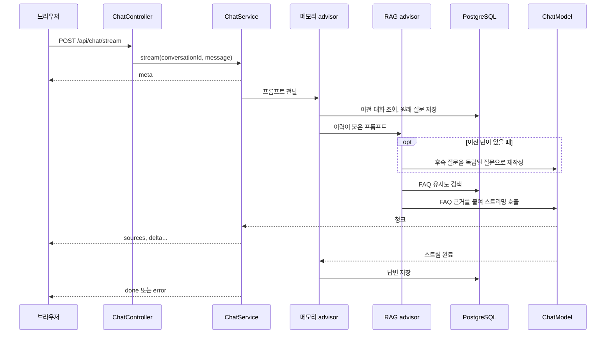

# 구조

한 번의 요청이 어떻게 처리되는지와 각 구성 요소의 역할을 설명합니다. 실행 방법과 API 계약은 [README](../README.md)에 있습니다.

## 요청 흐름

메모리 advisor의 순서가 RAG보다 앞서므로, 저장되는 질문은 FAQ가 붙기 전의 원문입니다.

## 구성 요소

| 위치 | 역할 |
|---|---|
| `chat/ChatController` | 입력 검증, `ChatEvent`를 SSE 이벤트로 변환, 프록시 버퍼링 방지 헤더 |
| `chat/ChatService` | 모델 응답을 이벤트로 변환, 유휴 타임아웃, 실패를 `error` 이벤트로 변환 |
| `chat/RagConfig` | `ChatClient`와 advisor 조립, 프롬프트, 재작성과 빈 답변 처리 |
| `faq/FaqSync` | 기동할 때 `faqs.json`을 벡터 저장소와 동기화 |
| `faq/FaqController` | FAQ 검색 API |
| `demo/` | `demo` 프로필의 스텁 임베딩과 스텁 답변 |
| `ApiKeyGuard` | API 키 환경 변수가 없으면 기동 실패 |
| `static/index.html` | 스트림을 읽어 표시하는 채팅 화면 |

## 데이터

PostgreSQL 하나에 두 테이블을 둡니다. 스키마는 Spring AI의 초기화 옵션으로 만듭니다.

| 테이블 | 내용 | 수명 |
|---|---|---|
| `vector_store` | FAQ 본문, 메타데이터, 해시, 임베딩(1536차원) | `faqs.json`과 동기화 |
| `spring_ai_chat_memory` | 대화별 메시지 | 삭제 정책 없음 |

FAQ 해시에는 내용과 `consult.embedding-index`가 포함됩니다. 그래서 내용이나 임베딩 방식이 바뀐 항목만 다시 임베딩하고, 데모와 실제 모드의 벡터가 섞이지 않습니다.

## 프로필

| | 기본 | `demo` |
|---|---|---|
| 답변 생성 | Claude | 검색된 FAQ 원문을 반환하는 스텁 |
| 임베딩 | OpenAI | 글자 2-gram 해시 |
| API 키 | 2개 필요 | 필요 없음 |
| 유사도 임계값 | 0.4 (초기값, 보정 전) | 0.18 (측정값) |

두 프로필 모두 검색, 대화 기록, advisor 체인, SSE는 같은 코드를 씁니다.
