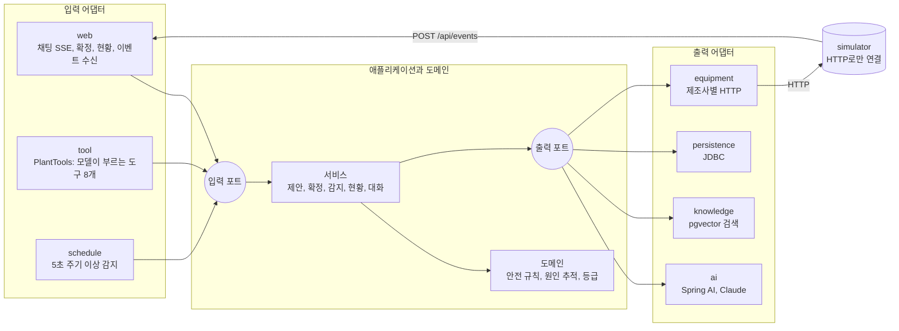
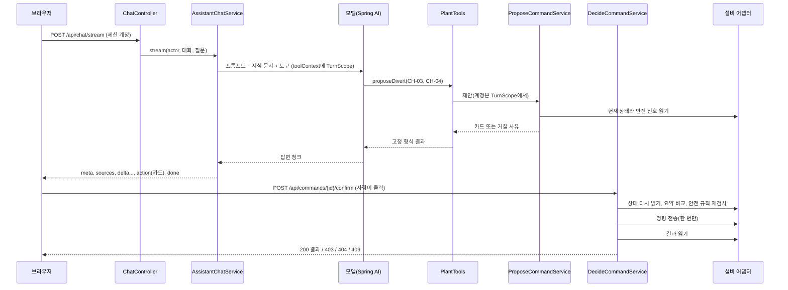
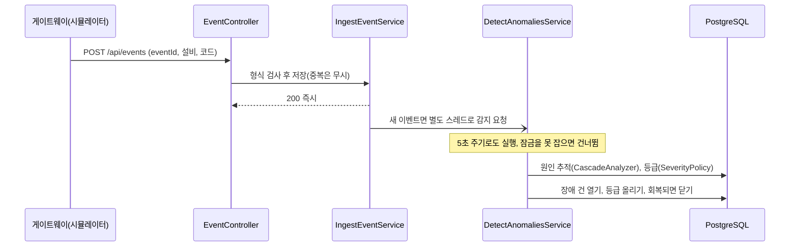

# 구조

구성 요소의 역할과 요청이 처리되는 흐름을 설명합니다. 실행 방법과 API 표는 [README](../README.md), 왜 이렇게 만들었는지는 [설계 결정](decisions.md)에 있습니다.

## 헥사고날 배치

- 의존은 바깥에서 안쪽으로만 갑니다. `ArchitectureTest`가 이를 검사합니다.
- 도구 어댑터는 입력 포트만 부릅니다. 확정 포트를 부를 수 있는 것은 웹의 확정 API뿐입니다.
- 시뮬레이터는 같은 프로세스에서 돌지만 코드로는 참조하지 않고 HTTP로만 연결합니다. 실제 설비로 바꿀 때는 `adapter/out/equipment`만 바뀝니다.

## 흐름 1: 대화에서 제안, 사람이 확정

- 모델은 카드만 만들 수 있습니다. 확정 API에는 AI가 없습니다.
- 확정할 때 상태가 제안 시점과 다르면 보내지 않고 409로 끝납니다.
- 결과를 확인하지 못하면 다시 보내지 않고 `UNCONFIRMED`로 닫습니다.

## 흐름 2: 이벤트 수신과 이상 감지

## 데이터

PostgreSQL 하나에 둡니다. 제어 테이블은 `schema-control.sql`, 벡터와 대화 기록은 Spring AI 초기화 옵션으로 만듭니다.

| 테이블 | 내용 |
|---|---|
| `pending_commands` | 확인 카드. 상태(PENDING, EXECUTING, SUCCEEDED 등), 만료 시각, 제안 시점 상태 요약. 부분 유일 인덱스로 대상당 실행 중 1건 |
| `command_audit` | 카드 상태 변화 기록 |
| `equipment_events` | 설비 이벤트(코드만, 자유 문자열 없음). eventId로 중복 제거 |
| `incidents` | 장애 건과 등급. 설비와 종류당 열린 건 1개 |
| `maintenance_requests` | 정비 요청. 설비당 열린 건 1개 |
| `vector_store` | 지식 문서 본문, 해시, 임베딩 |
| `spring_ai_chat_memory` | 대화별 메시지 |

지식 문서 해시에는 제목, 본문, 분류와 `controltower.embedding-index`가 들어갑니다. 내용이나 임베딩 방식이 바뀐 문서만 다시 임베딩합니다.

## 프로필

| | 기본 | `demo` |
|---|---|---|
| 답변 생성 | Claude, 도구 호출 | 키워드로 도구를 부르는 스텁. 결과는 고정 문구로 답함 |
| 임베딩 | OpenAI | 글자 2-gram 해시 |
| API 키 | 2개 필요 | 필요 없음 |
| 유사도 임계값 | 0.4 (초기값, 보정 전) | 0.20 (측정값) |

두 프로필 모두 도구 실행, 안전 규칙, 확정 흐름, 저장소, SSE는 같은 코드를 씁니다. 데모의 스텁도 실제 도구 반복(`ToolCallingAdvisor`)을 거칩니다.
